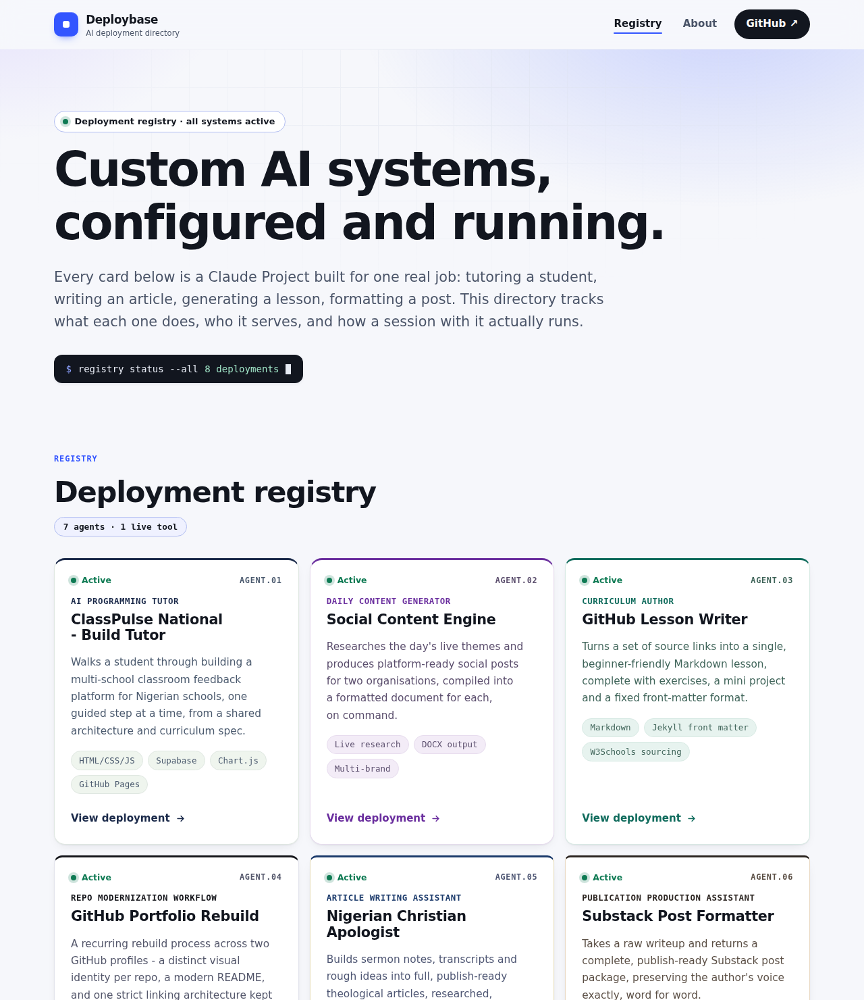
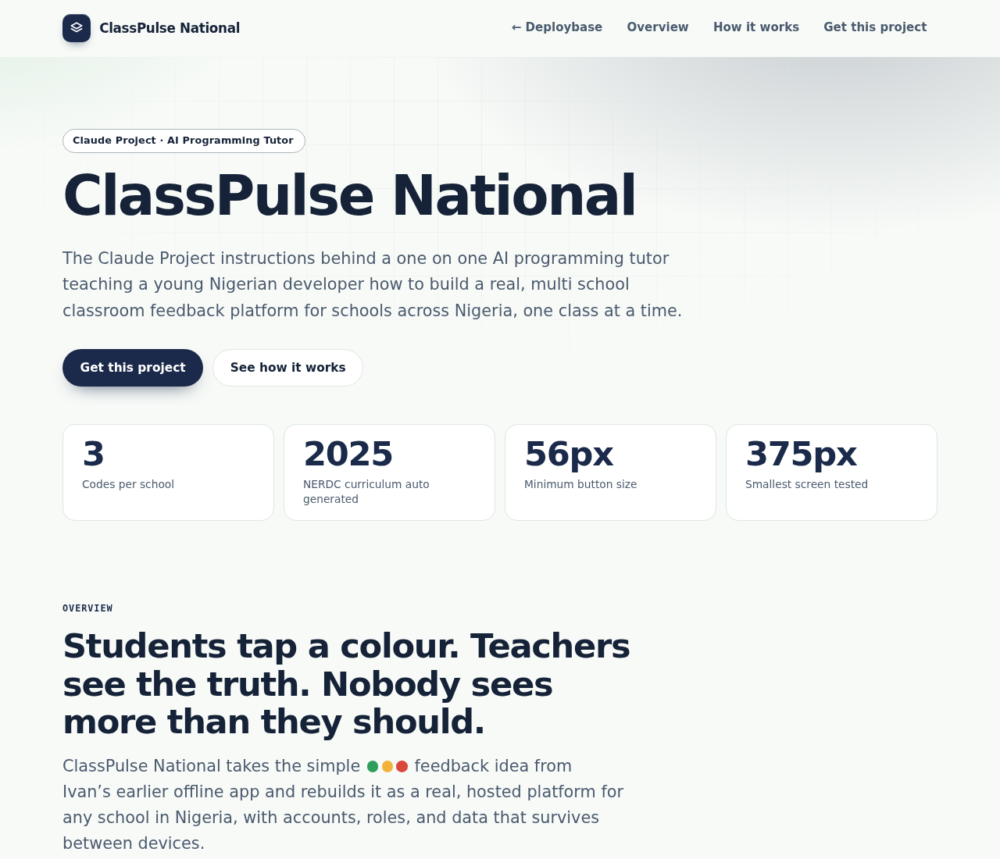

<div align="center">


# Deploybase

**A directory of configured, deployed AI systems, each with the exact instructions behind it.**

[](https://github.com/babatundeawo/deploybase/actions/workflows/deploy.yml)
[](https://github.com/babatundeawo/deploybase/actions/workflows/codeql.yml)

[Live site](https://babatundeawo.github.io/deploybase/) &middot; [Documentation](docs/) &middot; [Report an issue](https://github.com/babatundeawo/deploybase/issues)

</div>



## About

Deploybase lists every Claude Project (a custom AI system) built and run by Babatunde Awoyemi and Techbase Consultant Services. Each entry says what the system does, who it serves and how a session with it runs, then links to a page that holds the full write-up. It is for educators, developers and anyone who wants to see how a working AI assistant is configured, and to rebuild one for themselves.

## Features

- A registry of eight deployments: seven case-study pages and one live tool, the Educator AI Toolkit.
- A page for each project covering its purpose, how a session runs and the rules it never breaks.
- The exact custom instructions and knowledge files for each project, shown on the page with a one-tap copy button and a link to the raw file.
- Works on any screen from a small phone to a wide monitor, with full keyboard navigation and reduced-motion support.
- Readable without JavaScript. The file viewer and copy buttons need it, and each file also has a direct link.



## How to use it

1. Open the [registry](https://babatundeawo.github.io/deploybase/) and choose a deployment card.
2. Read the overview and how a session runs.
3. In the **Get this project** section, open a file and choose **Copy text**.
4. Create a new Project at [claude.ai](https://claude.ai), paste the custom instructions into its instructions field, and upload the guidelines file to its knowledge base.

## Tech stack

- HTML, CSS and vanilla JavaScript, with no framework and no runtime dependencies
- A small Node script that builds the registry, sitemap and link checks
- GitHub Actions and GitHub Pages for building and hosting
- Google Fonts, loaded per project

## Project structure

```
index.html              The registry (hub) page
<project-slug>/         One folder per deployment
  index.html            The project page
  files/                The original instruction and knowledge files, unmodified
assets/                 Shared stylesheet, theme colours, script and images
data/projects.json      The registry data that drives the hub cards
scripts/build.mjs       Builds the site and checks every link
docs/                   Guides for running and customising the site
.github/                Workflows for deployment and security scanning
```

## Contributing

Found a typo, a broken link or something that does not work on your device? Open an [issue](https://github.com/babatundeawo/deploybase/issues/new) on GitHub and describe what you saw, the page it happened on and the device or browser you used.

## Credits

Typefaces are served by Google Fonts under the SIL Open Font License: Sora, Inter, JetBrains Mono, Nunito, Plus Jakarta Sans, Space Grotesk, Manrope, Fraunces, Source Serif 4, Fredoka, Poppins and Libre Baskerville. The AI systems described here run on Claude by Anthropic.

## Contact

Built by [Babatunde Awoyemi](https://babatundeawo.github.io/) &middot; [GitHub profile](https://github.com/babatundeawo) &middot; [Techbase](https://github.com/techbaseng)
