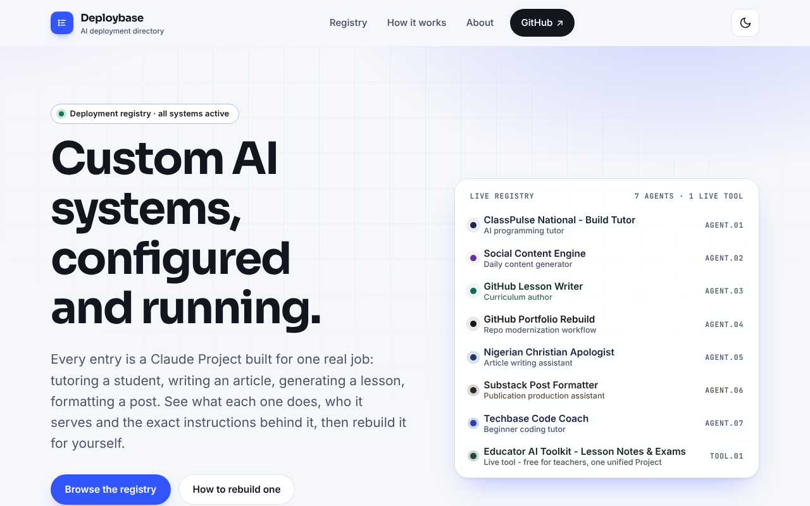
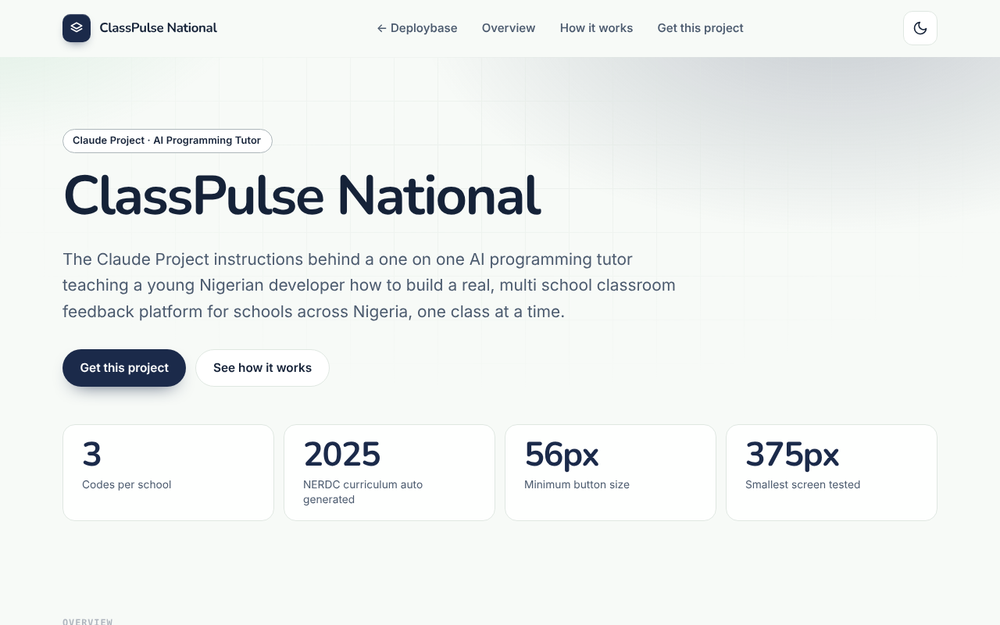

<div align="center">


# Deploybase

**A directory of configured, deployed AI systems, each with the exact instructions behind it.**

[](https://github.com/babatundeawo/deploybase/actions/workflows/deploy.yml)
[](https://github.com/babatundeawo/deploybase/actions/workflows/codeql.yml)

[Live site](https://babatundeawo.github.io/deploybase/) &middot; [Documentation](docs/) &middot; [Report an issue](https://github.com/babatundeawo/deploybase/issues)

</div>



## About

Deploybase lists every Claude Project (a custom AI system) built and run by Babatunde Awoyemi and Techbase Consultant Services. Each entry says what the system does, who it serves and how a session with it runs, then links to a page that holds the full write-up. It is for educators, developers and anyone who wants to see how a working AI assistant is configured, and to rebuild one for themselves.

## Features

- A registry of eight deployments: seven case-study pages and one live tool, the Educator AI Toolkit.
- A page for each project covering its purpose, how a session runs and the rules it never breaks.
- The exact custom instructions and knowledge files for each project, shown on the page with a one-tap copy button and a link to the raw file.
- Light and dark themes that follow the device setting, with a toggle that remembers your choice.
- Installs on Android, iPhone and desktop like an app, and opens offline. Pages you have visited stay available without a connection.
- Works on any screen from a small phone to a wide monitor, with full keyboard navigation and reduced-motion support.
- Readable without JavaScript. The file viewer, copy buttons and install prompt need it, and each file also has a direct link.
- No tracking, no third-party requests. Fonts and icons are served from the site itself.



## How to use it

1. Open the [registry](https://babatundeawo.github.io/deploybase/) and choose a deployment card.
2. Read the overview and how a session runs.
3. In the **Get this project** section, open a file and choose **Copy text**.
4. Create a new Project at [claude.ai](https://claude.ai), paste the custom instructions into its instructions field, and upload the guidelines file to its knowledge base.

## Tech stack

- HTML, CSS and vanilla JavaScript, with no framework and no runtime dependencies
- A small Node script that builds the registry, theme styles, service worker and sitemap, and checks every link
- GitHub Actions and GitHub Pages for building and hosting
- Self-hosted variable fonts and a hand-written service worker for offline use

## Project structure

```
index.html              The registry (hub) page
<project-slug>/         One folder per deployment
  index.html            The project page
  files/                The original instruction and knowledge files, unmodified
assets/                 Shared styles, scripts, fonts and images
data/projects.json      The registry data that drives the hub cards
data/themes.json        Colours and fonts for the hub and every project
scripts/build.mjs       Builds the site and checks every link
scripts/templates/      Service worker, 404 and offline page templates
docs/                   Guides for running and customising the site
.github/                Workflows for deployment, pull request checks and security scanning
```

## Contributing

Found a typo, a broken link or something that does not work on your device? Open an [issue](https://github.com/babatundeawo/deploybase/issues/new) and describe what you saw, the page it happened on and the device or browser you used. Developers can read [CONTRIBUTING.md](CONTRIBUTING.md) to run the site locally.

## Security

To report a vulnerability, see [SECURITY.md](SECURITY.md).

## Credits

Typefaces are self-hosted from [Fontsource](https://fontsource.org) under the SIL Open Font License 1.1: Sora, Inter, JetBrains Mono, Nunito, Plus Jakarta Sans, Space Grotesk, Manrope, Fraunces, Source Serif 4, Fredoka, Poppins and Libre Baskerville. The AI systems described here run on Claude by Anthropic.

## Contact

Built by [Babatunde Awoyemi](https://babatundeawo.github.io/) &middot; [GitHub profile](https://github.com/babatundeawo) &middot; [Techbase](https://github.com/techbaseng)
